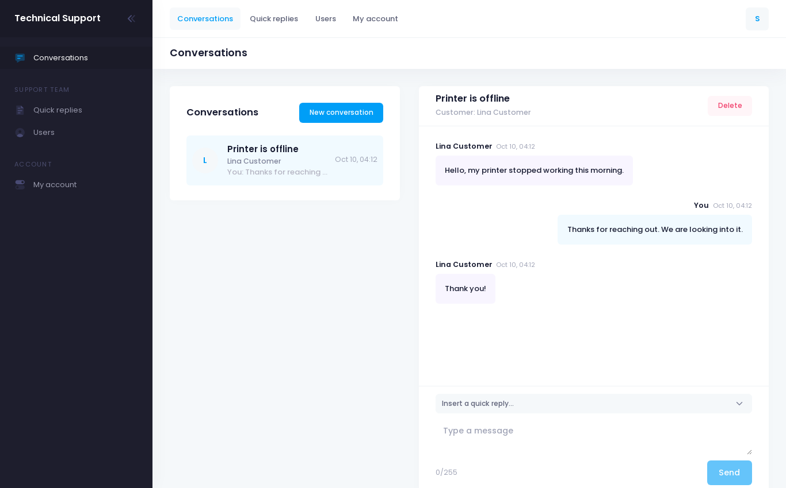
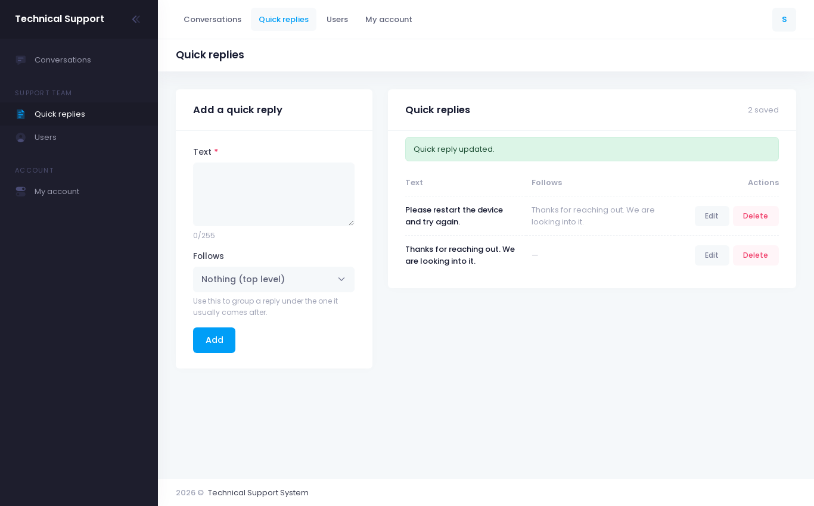
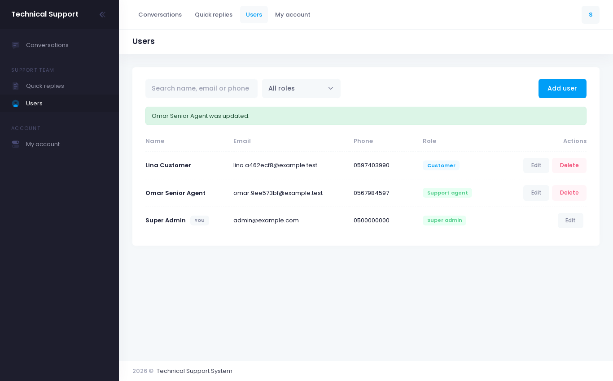
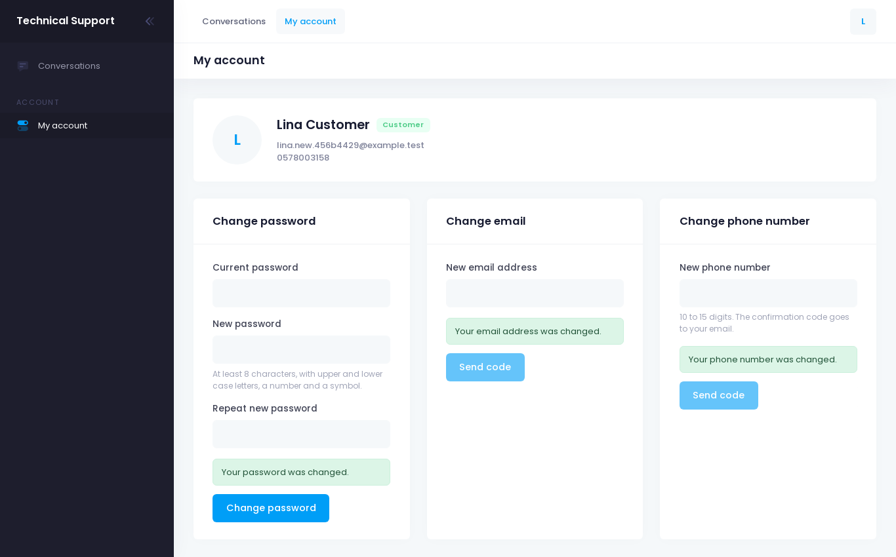
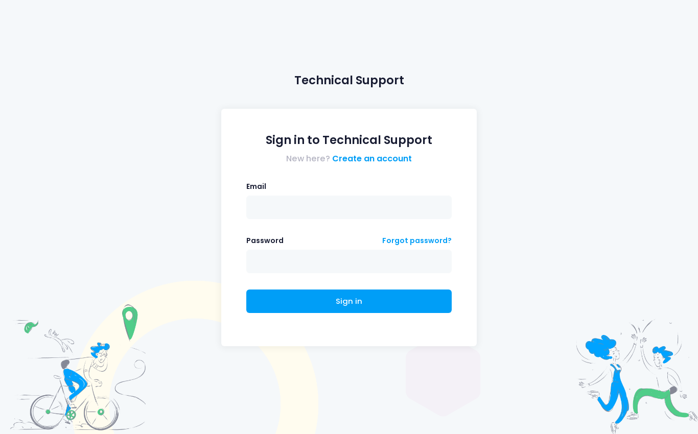

# Technical Support System: Front End

Angular front end for a technical support chat system. Customers open conversations with the support team, staff answer them, and both sides see new messages arrive without reloading.

The API lives in [technical-support-system-api](https://github.com/belalyasin/technical-support-system-api) (Laravel 11).



## What it does

**Everyone**

- Sign up, sign in, sign out
- Forgot password: a 4-digit code is emailed, then a new password is set with it
- Conversations: a list with unread counts and the latest message, a message thread, and a form to start a new conversation
- New messages and new conversations show up on their own (the page checks the API every few seconds while the tab is visible)
- My account: change password, email address and phone number (email and phone are confirmed with an emailed code)

**Support staff** (`admin` and `super admin`)

- See every customer's conversations and reply to them
- Open a conversation with a customer
- Delete a conversation
- Quick replies: a library of saved answers that can be dropped into a reply
- Users: search, filter by role, add, edit and delete accounts. Only a super admin can manage super admins

Customers do not see the staff pages, and the routes are guarded.

| Quick replies | Users |
| --- | --- |
|  |  |

| My account | Sign in |
| --- | --- |
|  |  |

## Tech stack

Angular 12, TypeScript, RxJS, Bootstrap 5. The layout and styling come from the Metronic 8 Angular template.

## Getting started

Start the API first (see its README). It allows requests from `http://localhost:4200` and its seeder creates a first super admin.

```bash
git clone https://github.com/belalyasin/technical-support-system-frontend.git
cd technical-support-system-frontend
npm install --legacy-peer-deps
npm start
```

Then open http://localhost:4200.

The API address is `apiBaseUrl` in `src/environments/environment.ts` (and `environment.prod.ts` for production builds). It defaults to `http://127.0.0.1:8000/api`.

On Node 17 or newer, Angular 12's build needs the legacy OpenSSL provider:

```bash
export NODE_OPTIONS=--openssl-legacy-provider
```

## Project structure

```
src/app/
  modules/auth/        login, registration, forgot password, guards, token interceptor
  modules/support/     conversations, quick replies, users, my account
    models.ts          types shared with the API
    services/          support-api.service.ts, one method per API call
    pages/             one folder per page
  _metronic/           layout, menus and shared template components
```

`AuthServiceService` keeps the signed-in user and the token. `TokenInterceptor` adds the token to every API request and signs the user out when the API answers 401. `AuthGuard`, `GuestGuard` and `StaffGuard` protect the routes.

The template's demo pages (dashboard widgets, wizards, sample profile) are still in the source tree but are no longer part of the app's routes.
